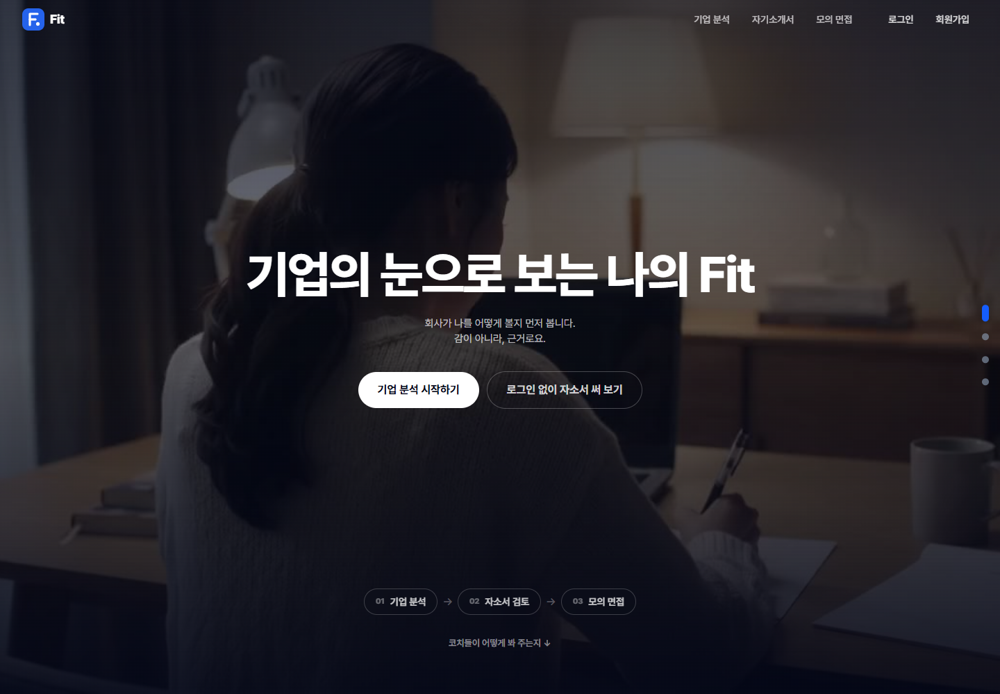
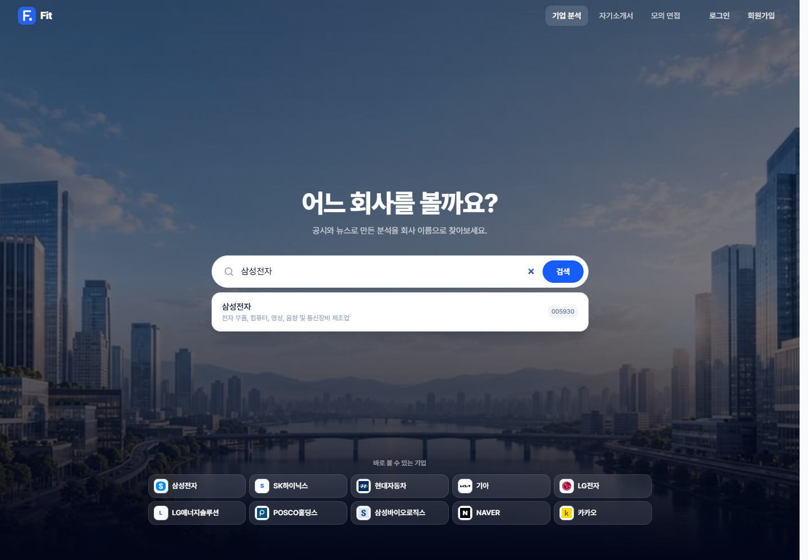
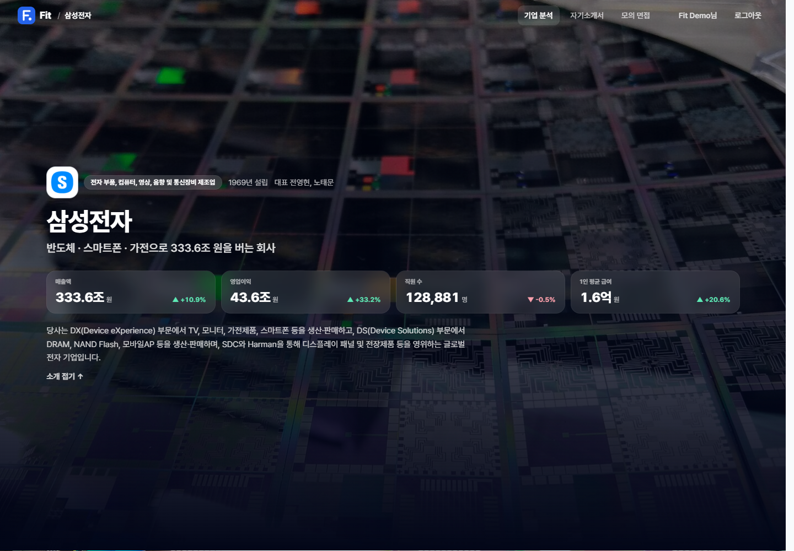
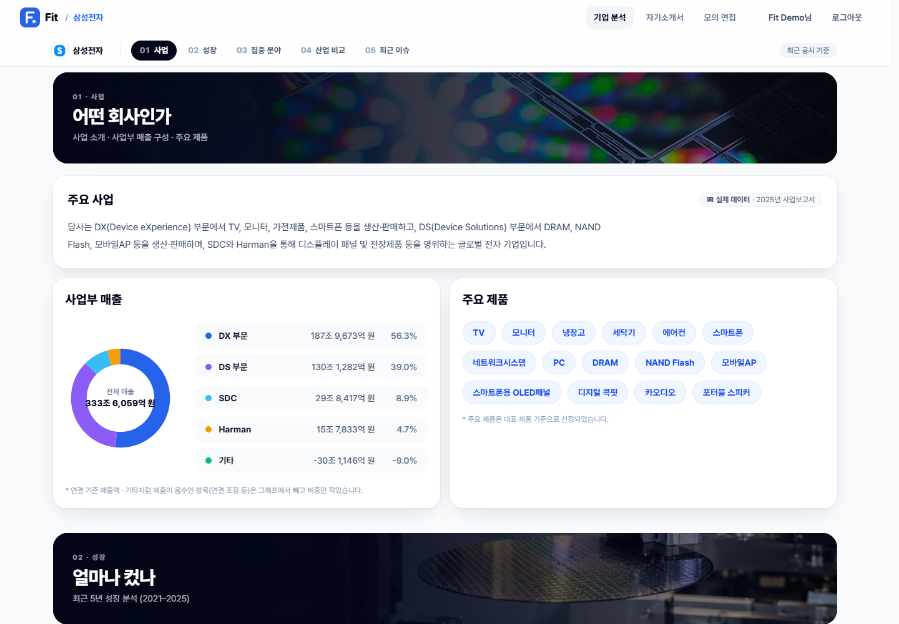
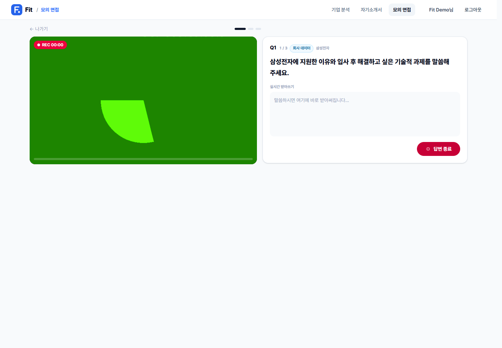
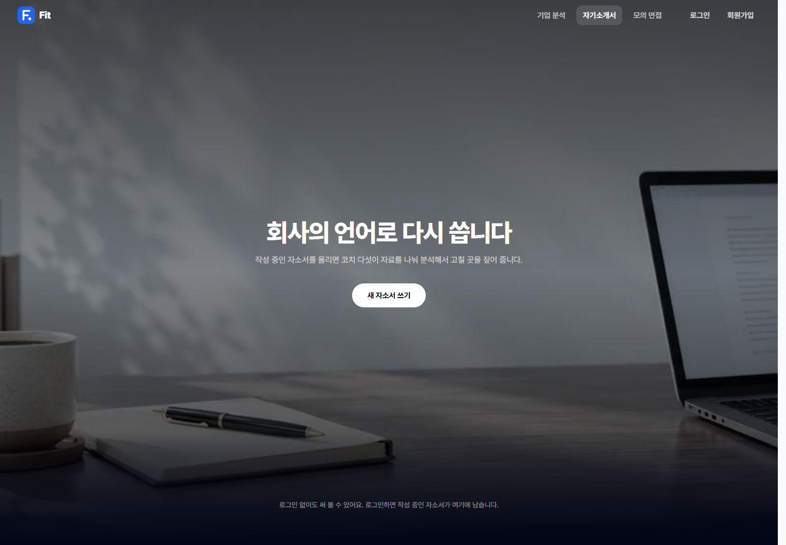
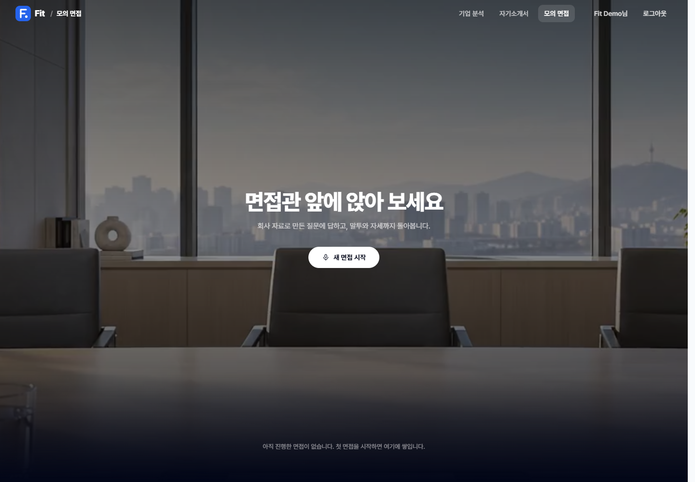
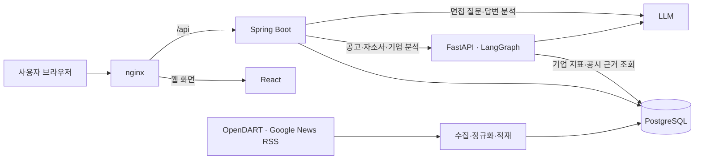

# Fit — 기업 공시에서 시작하는 자기소개서와 모의 면접

> SSAFY 15기 특화 프로젝트 · 빅데이터 분산 트랙 · 2026.08.24–2026.10.13

지원하려는 기업을 검색하고, **어떤 사업을 하는지, 무엇이 성장하고 있는지, 공고가 어떤 경험을 요구하는지** 확인한 뒤 자기소개서와 면접을 준비하는 웹 서비스입니다.

- **기업 분석** — OpenDART 공시에서 재무·인력·사업 지표를 정리하고, 같은 산업의 기업과 비교합니다.
- **자기소개서** — 공고와 문항별 초안을 놓고, AI 담당자에게 공고 요구사항·경험의 구체성·문장 구성 피드백을 받습니다.
- **모의 면접** — 질문과 꼬리질문에 답하고, 답변 내용과 카메라 기반 시선·머리 자세 리포트를 확인합니다.

## 화면



| 기업 검색 | 기업 상세 |
| --- | --- |
|  |  |
| **사업부 매출과 주요 제품** | **모의 면접 질문과 답변** |
|  |  |
| **자기소개서** | **모의 면접 진입** |
|  |  |

[새 면접 설정 화면](docs/screenshots/06-interview-setup.png)

> React·Spring Boot·PostgreSQL을 로컬에서 연결해 찍었습니다. 기업 검색과 상세에는 적재한 사업보고서 시드를 사용했습니다. 모의 면접 진행 화면은 로컬 테스트 계정으로 로그인한 뒤 예시 질문과 브라우저 가상 카메라를 사용해 캡처했습니다.

## 1. Introduction

사업보고서에서 필요한 숫자를 찾고, 채용공고를 읽어 내 경험을 정리하고, 면접 답변을 연습하는 작업은 보통 서로 다른 곳에서 진행됩니다. 기업 소개를 읽고도 자기소개서에 어떤 경험을 꺼내 써야 할지 판단하기 어렵고, 숫자를 인용할 때는 어느 연도의 어떤 자료인지 다시 찾아야 합니다.

Fit은 **기업 파악 → 공고와 내 경험 연결 → 글과 말로 연습**을 한 서비스에 묶었습니다. 주요 수치는 수집·정규화한 데이터를 조회하고, 서술형 질문에는 사업보고서 문단을 검색해 문맥을 보탭니다. 공고와 경험을 연결할 때는 사용자가 제공한 원문에 실제로 있는 인용을 검사합니다.

## 2. Key Features

| 영역 | 기능 |
| --- | --- |
| 기업 검색 | 상장사 시드 2,662개사 검색, 기업 기본정보와 산업 분류 조회 |
| 기업 상세 | 매출·영업이익·직원 수 등 핵심 지표, 기간별 재무 추이, 동일 산업 비교, 사업과 집중 분야, 최근 이슈 |
| 공고 분석 | 공고에서 직무와 요구사항을 정리하고, 사용자가 쓴 경험과 연결할 근거를 찾음 |
| 자기소개서 | 문항별 초안 작성, 담당자와 대화하는 검토방, 담당별 피드백과 총괄 요약 |
| 모의 면접 | 질문·꼬리질문 생성, 답변 분석, MediaPipe 기반 시선·머리 자세 분석, 면접 리포트 |
| 계정 | 회원가입, 이메일 인증, 로그인, 작성·면접 기록 관리 |

## 3. Tech Stack

| 계층 | 기술 |
| --- | --- |
| 웹 |      |
| 백엔드 |      |
| AI |      |
| 데이터 |    |
| 인프라 / CI |    |
| 테스트 |    |
| 외부 데이터 | OpenDART 공시 · Google News RSS |

## 4. Architecture



- **Spring Boot**가 인증, 데이터 접근 권한, 사용자 기록을 맡습니다. 브라우저 요청은 Spring을 거쳐 내부 AI 서비스로 전달됩니다.
- **FastAPI**는 공고·경험·글쓰기 분석과 기업 근거 검색을 처리합니다. 총괄은 요청에 필요한 담당을 고르고 결과를 종합합니다.
- **데이터 파이프라인**은 웹 요청 경로와 별도로 돌아갑니다. 수집·정규화한 자료를 적재하면 화면 API와 기업 분석 담당이 함께 조회합니다.

[DB 스키마](docs/design/db-schema.md) · [총괄 에이전트 API](docs/api/supervisor-agent-api.md) · [인프라 구성](infra/README.md)

## 5. 기업 분석 — 수치와 서술의 근거를 나눠 다룬다

매출이나 직원 수처럼 기준연도와 단위가 있는 값은 **정규화한 지표**에서 가져옵니다. 해외 사업이나 사업부 변화처럼 설명이 필요한 질문은 **사업보고서 문단과 표**에서 근거를 찾습니다. 누락된 지표는 화면에서 미제공으로 표시합니다.

공시 검색은 키워드 검색(BM25), 임베딩 벡터 검색, 두 순위를 결합하는 하이브리드 검색(RRF)을 비교했습니다. 사람이 확정한 **53문항**에서 아래 결과를 기록했습니다.

| 검색 방식 | Recall@1 | Recall@8 | MRR |
| --- | ---: | ---: | ---: |
| BM25 | 0.340 | 0.774 | 0.488 |
| 벡터 | **0.509** | 0.830 | **0.627** |
| 하이브리드 | 0.472 | **0.868** | 0.610 |

채팅에 넣는 상위 8건 기준으로 하이브리드 검색은 53문항 중 46문항에서 정답 문단을 찾았습니다. 벡터 검색은 첫 결과와 평균 순위에서 앞섰습니다. 이 수치는 해당 청크 버전의 **검색 기준선**이며, 최종 답변의 정확도는 별도 지표입니다.

[검색 기준선과 실패 문항](ai/evals/company_analysis/results/2026-09-19-gold53-retrieval-baseline.md) · [기업 분석 담당 API](docs/api/company-analysis-agent.md) · [결측 응답 규칙](docs/decisions/0001-missing-data-response.md)

## 6. 자기소개서 AI — 공고와 경험을 원문으로 연결한다

총괄은 질문에 따라 공고, 경험, 기업 분석 등 필요한 담당을 실행합니다. 글쓰기 담당은 질문과 글자 수 제한을 받아 초안을 검토하고, 분석 결과가 있으면 피드백에 반영합니다.

공고 요구사항과 경험을 연결하는 기준선에서는 모델이 **필요한 근거의 유무와 경험 원문 인용**을 반환하고, Python 코드가 인용의 존재 여부를 검사해 최종 라벨을 계산했습니다. 원문에 없는 인용으로 검증에 실패한 1건은 오답으로 반영했습니다.

| 평가 범위 | 연결 | 정확도 | Macro F1 |
| --- | ---: | ---: | ---: |
| 전체 회귀 평가 | 55건 | 90.9% | 0.908 |
| 처음 평가한 신규 사례 | 9건 | 77.8% | 0.722 |

신규 사례에서는 일반적인 API 운영 경험을 높은 SLA 조건의 운영으로 인정하거나, 주행 로그 분석을 실제 주행 테스트 수행으로 넓혀 해석하는 오류가 있었습니다. 평가 표본이 작고 전체 회귀 평가에는 정책 조정에 사용한 사례가 포함되어 있습니다.

[공고 연결 기준선과 오류 사례](ai/docs/jd-baseline-evaluation-results.md) · [공고 분석 API](docs/api/jd-coaching-api.md) · [글쓰기 API](docs/api/writing-agent-api.md)

## 7. 데이터와 배포

| 과제 | 구현 |
| --- | --- |
| 공시를 화면에서 조회할 형태로 만들기 | 기업·지표·사업부 데이터를 정규화하고, 기업 마스터와 후속 지표 시드를 순서대로 적재합니다. |
| 적재를 다시 실행하기 | 자연키가 있는 표는 upsert를 사용하고, 일부 표는 시드 소유 범위를 명시해 교체합니다. |
| 뉴스 갱신 | Google News RSS 수집부터 스테이징·적재까지 별도 파이프라인으로 운영하도록 구성했습니다. |
| 배포 후 상태 확인 | Jenkins에서 Compose 배포를 실행하고 컨테이너 상태를 확인합니다. 실패하면 이전 이미지가 있는 서비스의 이미지 태그를 되돌립니다. DB 스키마는 별도 복구 대상입니다. |

[데이터 파이프라인](data/README.md) · [시드 적재 코드](data/scripts/load_seed_csv.py) · [뉴스 적재 설계](data/docs/S15P21A504-NEWS-LOAD-PIPELINE.md) · [배포 스크립트](infra/deploy.sh)

## 8. Usage

### 화면 데모

Node.js 24로 실행하고 [localhost:5173](http://localhost:5173)에 접속합니다. 기업 분석 화면은 기본 개발 모드에서 mock 데이터를 사용합니다.

```bash
cd frontend
npm ci
npm run dev
```

### 전체 스택

Docker Compose와 Bash가 필요합니다. 공개 저장소에서는 환경 파일을 로컬에서 작성합니다. `infra/.env.local`에 아래 값을 넣습니다. DB 비밀번호 예시는 로컬 실행 전용입니다.

```dotenv
ENV_NAME=local
COMPOSE_PROJECT_NAME=ca-local
TAG=local
POSTGRES_PASSWORD=fit-local-dev
AI_ROOT_PATH=
AI_INTERVIEW_PROVIDER=gms
VLLM_BASE_URL=http://host.docker.internal:8000
```

저장소 루트에서 실행하고 [localhost:3000](http://localhost:3000)에 접속합니다.

```bash
./infra/local.sh
```

- 새 DB에는 기업 데이터가 비어 있습니다. 기업 검색부터 보려면 [데이터 적재 안내](data/README.md)에 따라 로컬 DB에 기업 마스터를 먼저 넣습니다.
- Vite 개발 서버에서 실제 API를 쓸 때는 `frontend/.env.api`에 `VITE_API_MOCK=false`를 설정한 뒤 `npm run dev:api`를 실행합니다. 로컬 Spring API는 기본 포트 8080을 사용합니다.
- 모델 호출에는 사용하는 공급자의 별도 설정이 필요합니다. [인프라 설정](infra/README.md) · [담당별 LLM 설정](ai/docs/llm-model-assignment.md)
- 로컬 회원가입은 로컬 DB에 계정을 만듭니다. SMTP가 비어 있으면 Spring 로그에 인증 링크가 출력됩니다. 링크의 호스트와 포트가 현재 프론트 주소와 다르면 `/verify?token=…` 경로를 유지하고 프론트 주소로 바꿔 엽니다.

## 9. Directory Structure

```text
Fit/
├── frontend/          # React 웹 화면, API 클라이언트, mock 데이터
│   └── src/features/  # 기업 검색·상세, 자소서, 면접 기능
├── backend/           # Spring Boot API, 인증, 사용자 기록
│   └── src/main/resources/db/migration/
├── ai/                # FastAPI, 담당별 에이전트, 총괄, RAG
│   ├── supervisor/    # 담당 선택과 결과 종합
│   └── evals/         # 평가 데이터와 기준선 결과
├── data/              # 수집·정규화·적재 스크립트와 기업 시드
├── infra/             # Compose, nginx, Jenkins, 로컬 실행·배포
└── docs/              # 설계, API 계약, 의사결정 기록, 화면 캡처
```

## 10. Testing

| 영역 | 실행 방법 |
| --- | --- |
| 웹 | `cd frontend && npm ci && npm run test -- --run` |
| 백엔드 | `cd backend && ./gradlew test` |
| AI | 루트에서 `python -m pip install -r ai/requirements-dev.txt` 후 `python -m unittest discover -s ai/tests -t .` |
| AI 품질 | [평가 데이터와 결과](ai/evals/)에서 기능별 기준선과 검토 범위 확인 |

로컬 캡처 당시에는 Spring 헬스체크와 웹을 통한 기업 상세 API 응답을 확인했습니다. 위 표는 영역별 테스트 실행 방법입니다.

## 11. Contributors

SSAFY 15기 특화 프로젝트 · 서울 5반 A504

[GitHub 기여 이력](https://github.com/Apple7575/Fit/graphs/contributors) · [프로젝트 문서 목차](docs/README.md) · [개발 당시 기여 가이드](CONTRIBUTING.md)
