# DB 스키마 설계 (F-25)

- 대상 이슈: `S15P21A504-34`
- DBMS: PostgreSQL 18
- 기준 문서: Notion [기업분석 API 명세서](https://app.notion.com/p/3c97eaa01a88802ab705fdae578e3b54) (F-33, 완료)
- **ERD 기준 문서: Notion [기업 정보 ERD](https://rigorous-rook-646.notion.site/ERD-3ce305563fdc80d29b72f46e55897595) (확정)** — 테이블·컬럼은 이 문서가 원본이다. 어긋나면 명세를 따르고, 명세를 바꿔야 하면 Notion을 먼저 고친다.
- 마이그레이션: Flyway (`backend/src/main/resources/db/migration/`)

---

## 1. 설계 원칙

**지표를 컬럼이 아니라 행으로 둔다.** API 명세가 `/metrics/{metric}` 형태로 지표를 경로변수에 두므로,
지표를 `company_metric` 테이블의 컬럼(`revenue`, `operating_profit`, …)으로 만들면 컨트롤러에서
경로변수를 컬럼명으로 분기하는 코드가 생기고 지표 추가마다 DDL 변경이 필요하다.
`metric` 카탈로그 + `(corp_code, fiscal_year, metric_code)` 조합으로 두면 8개 엔드포인트가
모두 같은 테이블에 대한 조건절 차이로만 표현된다.

**원본과 가공본을 분리한다.** `dart_financial_account`에 DART 응답을 계정명 그대로 적재하고,
`company_metric`에는 매핑·정규화된 값만 넣는다. 계정 매핑 규칙(F-27)이 바뀌어도 DART를 다시
호출하지 않고 재처리할 수 있다. 조회 API는 `company_metric`만 읽는다.

> 이 판단으로 만든 착지 테이블은 확정 ERD 명세서에 없다. 2-1 참고.

---

## 2. ERD

```mermaid
erDiagram
    industry ||--o{ company : "분류"
    company  ||--o{ company_metric : "보유"
    metric   ||--o{ company_metric : "정의"
    company  ||--o{ company_business : "개요"
    company  ||--o{ company_segment : "개요"
    company  ||--o{ company_product : "개요"
    company  ||--o{ company_focus_direction : "집중"
    company_focus_direction ||--o{ company_focus_direction_item : "목록"
    company  ||--o{ company_rnd_field : "집중"
    company  ||--o{ company_activity : "집중"
    company  ||--o{ company_news : "이슈"
    company  ||--o{ dart_financial_account : "원본"
    company  ||--o{ dart_employee_status : "원본"
    company  ||--o{ staging_dart_otr_cpr_invstmnt : "원본"

    industry {
        varchar industry_code PK
        varchar industry_name
    }
    company {
        varchar corp_code PK "DART 고유번호 8자리"
        varchar corp_name
        varchar stock_code "상장사만"
        varchar corp_cls "Y/K/N/E"
        varchar industry_code FK
        varchar ceo_nm
        date established_date
        varchar dart_modify_date "증분 수집용"
    }
    metric {
        varchar metric_code PK "URL 경로변수 값(snake_case)"
        varchar name_ko
        varchar unit "KRW/PERSON/YEAR/%"
        varchar source_type
        smallint display_order
    }
    company_metric {
        varchar corp_code PK,FK
        smallint fiscal_year PK
        varchar metric_code PK,FK
        numeric metric_value
        varchar fs_div "OFS/CFS"
    }
    company_business {
        varchar corp_code PK,FK
        smallint fiscal_year PK
        varchar business_name PK
        smallint display_order "사업보고서 기재 순서"
    }
    company_segment {
        varchar corp_code PK,FK
        smallint fiscal_year PK
        varchar segment_code PK "사업보고서 표기 그대로"
        numeric revenue "미공시는 NULL"
        integer employee_count "미공시는 NULL"
    }
    company_product {
        varchar corp_code PK,FK
        smallint fiscal_year PK
        varchar product_name PK
        smallint display_order "사업보고서 기재 순서"
    }
    company_focus_direction {
        varchar corp_code PK,FK
        smallint fiscal_year PK
        text strategy_change "AI 생성물"
        timestamptz generated_at
    }
    company_focus_direction_item {
        varchar corp_code PK,FK
        smallint fiscal_year PK,FK
        varchar item_type PK "NEW_BUSINESS/KEYWORD"
        varchar item_name PK
        smallint display_order "AI 가 낸 순서"
    }
    company_rnd_field {
        varchar corp_code PK,FK
        smallint fiscal_year PK
        varchar field_name PK
        smallint display_order
    }
    company_activity {
        bigint id PK
        varchar corp_code FK
        smallint fiscal_year
        varchar activity_type "API 의 type 값 그대로"
        varchar field_name
        varchar purpose
        numeric amount "미공시는 NULL"
        varchar rcept_no "근거 공시"
    }
    company_news {
        bigint id PK
        varchar corp_code FK
        varchar title
        text description
        timestamptz published_at "NULL 이면 조회에 안 걸림"
        varchar original_url "중복 방지 키"
        varchar category "AI 분류, 실패는 NULL"
        varchar related_business "AI"
        numeric importance_score "AI 0.0~10.0"
    }
    dart_financial_account {
        bigint id PK
        varchar corp_code FK
        smallint bsns_year
        varchar reprt_code
        varchar fs_div
        varchar sj_div
        varchar account_nm
        numeric thstrm_amount
    }
    dart_employee_status {
        bigint id PK
        varchar corp_code FK
        smallint bsns_year
        varchar fo_bbm "사업부문"
        varchar sexdstn "성별"
        integer sm "합계 인원"
        text avrg_cnwk_sdytrn "원문 그대로"
        numeric fyer_salary_totamt
    }
    collection_run {
        bigint id PK
        varchar run_type
        smallint target_year
        varchar status
        integer success_count
        integer fail_count
    }
    staging_dart_otr_cpr_invstmnt {
        bigint id PK
        varchar corp_code FK "public.company 참조"
        smallint bsns_year
        varchar reprt_code
        smallint row_no "응답 안 행 번호"
        boolean is_total "합계 행. 집계에서 제외"
        varchar inv_prm "피출자회사"
        numeric trmend_blce_acntbk_amount "기말 장부가액"
    }
```



> `staging_dart_otr_cpr_invstmnt` 는 실제로는 `staging` 스키마의 `dart_otr_cpr_invstmnt` 다.
> mermaid 가 이름에 점을 못 써서 밑줄로 적었다.

### 2-1. 명세 외 테이블 (정리 대상, S15P21A504-120)

위 다이어그램의 `dart_financial_account`, `dart_employee_status`, `collection_run` **세 테이블은 확정 ERD 명세서에 없다.**
V1 초기 스키마에서 "원본과 가공본을 분리한다"는 판단으로 함께 만들었으나, 그 판단이 명세에 반영된 적이 없다.

조회 API는 세 테이블을 읽지 않는다. 백엔드에는 정의만 있고 쿼리가 하나도 없다.
실제 사용처는 파이썬 파이프라인이다 — 원본 적재는 `data/scripts/load_raw.py`, 수집 로그는 `data/scripts/load_metrics.py`.

**새 코드에서 이 세 테이블에 의존하지 않는다.** 존치 여부는 S15P21A504-120에서 파이프라인 담당과 합의해 정한다.
그 전까지는 지우지도 확장하지도 않는다.

`metric_evidence`(V5)도 명세에 없으나 정규화 검증(S15P21A504-84)이 쓰고 있어 이 정리 범위에 넣지 않았다.

**새 착지 테이블은 `staging` 스키마에 만든다.** V9 의 `staging.dart_otr_cpr_invstmnt` 가 첫 사례다.

`public` 을 확정 ERD 명세서와 일치시키는 것이 이 정리의 목적이므로, 착지 테이블을 `public` 에 두면
새로 만드는 족족 정리 대상이 된다 — 만들자마자 옮기는 왕복이 생긴다. 그래서 처음부터 `staging` 에 만들기로
파이프라인 담당과 합의했다(S15P21A504-120 회신 5장). 위 세 테이블도 같은 이유로 `staging` 이동이 예정돼 있고,
`dart_financial_account` 는 읽는 곳이 없어 삭제하기로 했다.

파이프라인은 테이블 이름을 스키마 없이 쓰고 `connect()` 의 `search_path` 로 푼다(`data/pipeline/db.py`).
백엔드의 `search_path` 는 `public` 그대로 두므로 조회 API 와 엔티티 검증은 이 스키마를 보지 않는다.

---

## 3. API ↔ 쿼리 매핑

명세의 엔드포인트가 모두 커버되는지 확인한 표다. 폐기된 개별 지표 조회 2종은 v2에서 응답 코드를
지웠으나 쿼리 형태 기록으로 남겨 둔다.

| 엔드포인트 | 읽는 테이블 | 핵심 조건 | 사용 인덱스 |
| --- | --- | --- | --- |
| `GET /api/companies` | `company` | `corp_name LIKE '%?%'` | `company_corp_name_trgm_idx` |
| `GET /api/companies/{corpCode}` | `company` + `industry` | PK 조회 | PK |
| `GET .../profile` | `company_business` + `company_segment` + `company_product` | `corp_code=? AND fiscal_year=?` | PK 선두 |
| `GET .../focus` | `company_focus_direction` (+`_item`) + `company_rnd_field` + `metric` ⟕ `company_metric` | `corp_code=? AND fiscal_year=?`, 지표는 `rd_cost`·`rd_ratio` | PK 선두 |
| `GET .../segments` | `company_segment` 자기조인 + `metric` ⟕ `company_metric` | `corp_code=?` + `fiscal_year IN (?, ?-1)` | PK 선두 |
| `GET .../activities` | `company_activity` | `corp_code=? AND activity_type=?` + 연도 범위 | `company_activity_lookup_idx` |
| `GET .../news` | `company_news` | `corp_code=?` + `published_at >= 기준시각` (+ `category=?`) | `company_news_latest_idx`, `company_news_category_idx` |
| `GET .../news/stats` | `company_news` | 위 + 조건부 집계와 카테고리 묶음 | 같음 |
| `GET .../news/top` | `company_news` | 위 + `importance_score IS NOT NULL` | `company_news_importance_idx` |
| `GET .../metrics` | `company_metric` + `metric` | `corp_code=? AND fiscal_year=?` | PK 선두 |
| `GET .../metrics/{metric}` | `company_metric` | `corp_code=? AND fiscal_year=? AND metric_code=?` | PK |
| `GET .../metrics/timeseries` | `company_metric` | `corp_code=? AND fiscal_year BETWEEN ? AND ?` | PK 선두 |
| `GET .../metrics/{metric}/timeseries` | `company_metric` | `corp_code=? AND metric_code=?` | `company_metric_timeseries_idx` |
| `GET .../industry-comparison` | `company` ⟕ `company_metric` + `metric` | `corp_code IN (대상+peers)` + `fiscal_year IN (?, ?-1)` | PK 선두 |
| `GET .../metrics/{metric}/industry-comparison` | `company_metric` ⋈ `company` | 위 + `metric_code=?` | `company_metric_comparison_idx` |
| `GET /api/industries/{industryCode}/companies` | `industry` + `company` ⟕ `company_metric` | `industry_code=?` + 정렬 지표의 산업 내 최신 연도 | `company_industry_code_idx`, `company_metric_timeseries_idx` |

기업 개요는 테이블 셋을 각각 읽는다. 하나로 합치는 조인을 쓰지 않는 이유는 세 목록이 서로
독립이어서, 조인하면 사업 3개 × 부문 2개 × 제품 6개가 36행으로 불어나고 자바에서 다시 중복을
걷어내야 하기 때문이다. 세 쿼리 모두 PK 선두 두 컬럼만 읽어 값이 없으면 즉시 빈 결과가 된다.

연도를 주지 않았을 때의 기준연도는 세 테이블의 `max(fiscal_year)`다. `company_metric`의 최신
연도(기업 헤더의 `dataYear`)를 쓰지 않는다. 재무 지표가 2025년까지 들어와 있어도 사업보고서
추출이 2024년까지면, 그 해로 조회한 개요는 전부 빈 값이 되어 실제로 있는 데이터를 없는 것처럼
보여준다. 개요가 어느 해 것인지는 응답의 `year`로 알려 준다.

`totalRevenue`와 `segments[].revenueShare`는 컬럼이 없다. 명세가 `totalRevenue`를
"부문 단순합"으로 정의했으므로 `company_segment.revenue`에서 조회 시점에 계산한다. 저장하면
부문이 하나 늘거나 재적재될 때 합계가 원본과 어긋나고, 어긋난 쪽이 응답에 나간다. `yoy`를
저장하지 않는 것과 같은 판단이다.

집중 분야 세 API 도 파생값을 저장하지 않는다. 부문 인력 증감은 `company_segment`를 전년
행과 자기조인해 빼고, R&D 증가율은 `rd_cost`의 전년 값과 비교해 만든다. R&D 금액과 매출
비중은 지표 카탈로그의 `rd_cost`·`rd_ratio`가 이미 담고 있어 테이블을 만들지 않았다.

전사 직원 순증감(`employeeTotalChange`)은 `employee_count` 지표의 전년 대비 차이다.
명세가 "부문 합과 불일치(산식 확정 필요)"로 열어 둔 값이었고 근거는
`docs/decisions/0002-employee-total-change.md`에 있다. 부문 증감의 합과 다른 것이
정상이므로, 두 숫자를 맞추려고 어느 한쪽을 고치면 안 된다.

`/focus`와 `/segments`의 기준연도는 자기 테이블만 보고 정하지 않는다. `/focus`는 사업 방향과
R&D 분야 외에 `rd_cost`·`rd_ratio`의 연도까지, `/segments`는 부문 테이블 외에
`employee_count`의 연도까지 함께 본다. 한 응답 안에 출처가 다른 블록이 섞여 있어서, 한쪽만
보고 해를 정하면 이미 적재된 다른 블록이 조용히 빈다. 사업 방향 분석은 아직 안 돌았는데
R&D 비용은 들어와 있는 기업이 실제로 그런 경우다.

`company_focus_direction_item`은 방향 본 행을 복합 FK 로 참조한다. 목록만 있고 본 행이 없는
상태를 막고, 기준연도를 정할 때 이 테이블을 따로 볼 필요가 없어진다.

최근 이슈 세 API 는 `company_news` 하나를 다르게 자른 결과다. 명세가 "`/news/top` 의 id 는
`/news` 의 id 와 동일해야 함"이라고 못박아 두었으므로 테이블을 나누면 그 약속을 지킬 수 없다.
AI 분석 결과(`category`·`related_business`·`importance_score`)도 별도 테이블로 빼지 않고 같은
행에 두었다. 분석이 실패한 뉴스도 목록에 나가야 해서 어차피 `LEFT JOIN` 이 되고, 그러면 조인을
지고 갈 이득이 없다.

기간은 SQL 의 `now()` 가 아니라 서비스가 `Clock` 빈으로 만든 기준 시각을 파라미터로 넘긴다.
`BaseYearResolver` 가 쓰는 그 시계다. SQL 안에서 현재 시각을 읽으면 "7일 전 기사가 걸리는지"를
테스트할 방법이 없고, 서버 표준시가 UTC 면 하루 경계가 서울과 어긋난다. 발행 시각을 모르는
뉴스는 기간에 속하는지 판단할 수 없어 세 API 어디에도 나가지 않는다.

`published_at` 은 시각까지 저장하고 응답에는 서울 기준 날짜로 잘라 내보낸다. 화면은 날짜만
보여주지만, 저장을 날짜로 하면 같은 날 기사들의 최신순 정렬이 무의미해진다.

`company_activity`와 `company_news`는 대리 키를 쓴다. 한 기업이 같은 해에 같은 유형의 이벤트를 여러 건 낼 수
있어 자연키가 서지 않는다. 그래서 재적재는 upsert 가 아니라 기업 × 연도 × 유형 단위로 지우고
다시 넣는 방식이 된다. 뉴스도 같은 기사를 여러 소스가 실으면 제목과 URL 이 조금씩 달라 자연키가
서지 않고, 무엇보다 명세가 응답의 `id` 를 정수로 정해 두었다. 중복은 원문 URL 에 부분 유니크
인덱스를 걸어 막고, URL 을 모르는 뉴스는 막지 못한 채 들어온다.

비교 후보 목록은 지표값을 응답에 싣지 않고 정렬에만 쓴다. 기준연도가 응답에 나가지 않으므로
연도를 파라미터로 받지 않고 "그 산업 안에서 정렬 지표의 값이 있는 가장 최근 해"를 서브쿼리로 정한다.
기업마다 제 최신연도를 쓰면 서로 다른 해의 값으로 순위가 매겨진다. 값이 없는 기업도
`LEFT JOIN` 으로 목록에 남고 `NULLS LAST` 로 뒤에 붙는다 — 후보 목록에서 빠지면 고를 방법이 없다.

산업 비교는 v2에서 "산업 전체 자동 비교"가 "사용자가 고른 peers(최대 3) 비교"로 바뀌었다.
그래서 산업으로 범위를 넓히지 않고 대상 기업과 peers의 `corp_code`만 읽는다.
산업 전체를 읽고 자바에서 걸러내면 기업이 많은 산업에서 쓰지 않을 행을 전부 끌고 오게 된다.

```sql
SELECT c.corp_code, c.corp_name, cm.metric_code, cm.fiscal_year, cm.metric_value, m.value_scale
FROM company c
LEFT JOIN company_metric cm
       ON cm.corp_code   = c.corp_code
      AND cm.fiscal_year IN (:year, :prevYear)
      AND cm.metric_code IN (:metricCodes)
LEFT JOIN metric m ON m.metric_code = cm.metric_code
WHERE c.corp_code IN (:corpCodes);
```

연도를 둘 읽는 것은 매출 성장률 때문이다. 비교 지표 7종 중 `revenue_growth`와
`operating_margin`은 `company_metric`에 적재되지 않는 파생 지표이고, 각각 두 해치 매출과
같은 해의 영업이익·매출로 조회 시점에 계산한다. 그래서 요청한 지표를 그대로 조회에 넘기지 않고
원본 지표(`revenue`, `operating_profit`)로 바꿔서 넘긴다.

응답의 `industry.companyCount`는 이 쿼리와 별개로 `company`를 `industry_code`로 세어 만든다.
v1에서는 비교군에 실린 기업 수와 같았지만, v2는 고른 peers만 실으므로 둘이 갈린다.

---

## 4. 타입 선택 근거

| 선택 | 이유 |
| --- | --- |
| `corp_code`를 `VARCHAR(8)` + 정규식 CHECK | `CHAR(n)`은 공백 패딩 때문에 JDBC로 읽을 때 값 끝에 공백이 붙어 비교가 어긋난다. PostgreSQL에서 `CHAR`는 저장 공간 이득도 없다. |
| `metric_value`를 `NUMERIC(24,4)` | 금액은 원 단위 정수지만(삼성전자 자산총계 약 5×10^14) 비율·평균 근속연수 같은 소수 지표가 추가될 수 있어 소수부를 남겨 둔다. 부동소수점은 금액 비교에 부적합하다. |
| `metric_code`를 snake_case | 명세서가 `revenue`·`operating_profit`·`employee_count`·`avg_salary`·`avg_tenure`·`rd_ratio`로 확정. URL 경로변수 값과 DB 값을 동일하게 두어 컨트롤러에 매핑 코드가 생기지 않게 한다. |
| `avrg_cnwk_sdytrn`만 `TEXT` | 착지 테이블의 다른 수치는 자릿수 구분자만 제거하면 숫자지만, 평균 근속연수는 회사별 표기가 제각각이라 원문을 보존하고 F-27에서 파싱한다. |
| `fiscal_year`를 `SMALLINT` | 2021~2025 범위. CHECK로 1900~2100 제한. |

---

## 5. 다른 작업과의 경계

- **F-39 (PostgreSQL 컨테이너 초기화, 이민재)** — 스키마 생성은 Flyway가 애플리케이션 기동 시
  수행하므로 compose의 `docker-entrypoint-initdb.d`에 DDL을 넣지 않는다. 컨테이너는 빈 DB와
  `pg_trgm`을 만들 수 있는 권한만 제공하면 된다(`POSTGRES_USER`가 superuser이므로 현재 설정으로 충분).
- **F-27/F-28 (계정 매핑·Upsert, 여성욱)** — `dart_financial_account`가 착지 테이블,
  `company_metric`이 upsert 대상이다. `company_metric`의 upsert 키는 PK
  `(corp_code, fiscal_year, metric_code)`이므로 `ON CONFLICT` 절이 그대로 성립한다.
  `dart_financial_account.corp_code`가 `company`를 참조하므로 **기업 마스터(F-04) 적재가 재무 수집보다 먼저**여야 한다.
- **F-31 (Spring Boot·DB 연결, 본인)** — datasource 설정은 F-31에서 다룬다.
  compose는 이미 `SPRING_DATASOURCE_*` 환경변수를 주입하므로 컨테이너 환경에서는 값 주입이 따로 필요 없고,
  로컬 실행용 프로파일만 F-31에서 채우면 된다.

  > **의존성은 이 MR 이 아니라 F-31 이 소유한다.** 이 브랜치는 마이그레이션 파일과 설계 문서만 담는다.
  > Flyway·JPA 스타터를 여기서 넣으면 F-31 과 같은 줄에서 충돌하고, 무엇보다
  > Spring Boot 4 는 자동설정을 기술별 모듈로 쪼개 두어 `org.flywaydb:flyway-core` 만으로는
  > **자동설정이 붙지 않아 마이그레이션이 조용히 실행되지 않는다**(F-31 에서 실제로 겪었다).
  > `org.springframework.boot:spring-boot-flyway` 를 써야 하며, 그 결정과 검증은 F-31 에 있다.

---

## 6. 미결 사항

명세서(F-33)로 해소된 것: 지표 6종 키 확정, `metric_code` 표기(snake_case), 식별자는 `corpCode`(DART 고유번호).

1. **`rd_ratio` 조달 경로가 없다.** DART 정기보고서 주요정보 API 30개에 연구개발비·연구개발활동 항목이
   없음을 확인했다. 단일회사 **전체** 재무제표에서 `경상연구개발비` 계정을 찾는 방법은 판관비에 묶어
   공시하는 회사가 많아 커버리지가 보장되지 않고, XBRL 파싱은 MVP 대비 비용이 크다.
   명세가 `"value": null`을 허용하므로 스키마는 행 부재로 대응되지만, **F-24에서 표본 검증 후
   수집/제외를 결정**해야 한다.
2. **산업 분류를 무엇으로 채울지 미정.** 명세서 상위 페이지에 *"OpenDART는 기업별 업종코드를 깔끔하게
   주지 않습니다. KRX 업종분류 또는 KSIC 매핑 테이블을 별도로 넣어야 하며, 이것이 05번 API의 숨은
   난이도"* 라고 적혀 있다. 응답 예시의 `industryCode: "26"`은 KSIC 대분류 2자리다.
   `industry` 테이블 구조는 코드·명 2컬럼이라 어느 소스든 수용하지만, **적재 소스가 정해져야 한다.**
3. **연결/개별 재무제표 기준.** `fs_div`를 값으로만 보관하고 어느 쪽을 대표값으로 쓸지는 정하지 않았다.
   비교 가능성을 위해 한쪽으로 통일하는 규칙이 필요하다(일반적으로 연결 CFS 우선, 없으면 개별 OFS).
4. **`unit` 값 2개가 명세에 없다.** 명세 예시는 `KRW`와 `%`만 보여준다. `employee_count`를 `PERSON`,
   `avg_tenure`를 `YEAR`로 시드했으나 FE가 이 문자열로 포맷을 분기한다면 값 합의가 필요하다.

---

## 7. 응답 필드와 스키마 대응

명세의 성공 응답 필드가 전부 조달되는지 확인한 표다.

| 응답 필드 | 출처 |
| --- | --- |
| `corpCode`, `corpName`, `stockCode` | `company` 동명 컬럼 |
| `industryCode`, `industryName` | `industry` 조인 |
| `market` (KOSPI/KOSDAQ/KONEX) | `company.corp_cls`(Y/K/N)에서 파생 |
| `ceo`, `establishedDate` | `company.ceo_nm`, `company.established_date` |
| `metrics[].key`, `.label`, `.unit` | `metric` 카탈로그 |
| `metrics[].value` | `company_metric.metric_value`, 행이 없으면 `null` |
| `metrics[].yoy.prevValue` | 같은 테이블의 `fiscal_year - 1` 행 |
| `metrics[].yoy.changeRate` | 조회 시 계산. 전년 값이 없거나 0이면 `null` |
| 비교 `values.revenue_growth` | 조회 시 계산. `revenue`의 요청 연도와 전년 값. 전년이 없거나 0 이하면 `null` |
| 비교 `values.operating_margin` | 조회 시 계산. 같은 해의 `operating_profit ÷ revenue`. 매출이 0 이하면 `null` |
| 비교 `industry.companyCount` | `company`를 `industry_code`로 센 값. 응답에 실린 기업 수와 다르다 |

`yoy`는 저장하지 않는다. 전년 행이 같은 테이블에 있어 조회 시점에 계산하면 되고,
값을 저장하면 재적재 때 원본과 어긋날 여지가 생긴다. 비교 지표 7종 중 `revenue_growth`와
`operating_margin`도 같은 이유로 `metric` 카탈로그에 행을 두지 않고 계산해서 내보낸다.

---

## 8. 검증

PostgreSQL 18.6 컨테이너에 `psql -v ON_ERROR_STOP=1` 로 V1·V2를 적용해 확인했다.

**적용 결과** — 오류 없이 통과. 테이블 7개, 인덱스 17개, `metric` 시드 6행 생성.

**조회 쿼리** — 8개 엔드포인트가 쓸 쿼리 형태를 표본 데이터로 실행해 확인했다.

| 확인 항목 | 결과 |
| --- | --- |
| 단일지표 시계열 (`corp_code` + `metric_code` 필터, 연도 정렬) | 정상 |
| 산업 비교 (대상 기업의 `industry_code` 로 동종 기업 조회) | 정상 |
| yoy 계산 (전년 행 self-join, 전년 0이면 `NULL`) | 정상. 명세 예시와 동일한 `7.3` 산출 |
| 소수 지표 보존 (`avg_tenure` = 11.5) | 정상 |
| 기업명 부분일치 검색 | 정상 |

**제약조건** — 잘못된 데이터가 실제로 거부되는지 확인했다.

| 시도 | 결과 |
| --- | --- |
| `corp_code` 7자리 | 거부 (`company_corp_code_check`) |
| `corp_cls = 'X'` | 거부 (`company_corp_cls_check`) |
| 존재하지 않는 `metric_code` 참조 | 거부 (FK) |
| 기업·연도·지표 중복 | 거부 (PK) |
| 존재하지 않는 기업 참조 | 거부 (FK) |
| `unit = 'DOLLAR'` | 거부 (`metric_unit_check`) |
| `ON CONFLICT` upsert | 성공 (F-28 이 쓸 경로) |

**주의 — 조회 결과의 소수 자릿수.** `metric_value` 가 `NUMERIC(24,4)` 라서 금액도
`71000000000000.0000` 형태로 나온다. 명세는 `"value": 71000000000000` 을 기대하므로
**응답 직렬화 시 `metric.value_scale`(금액 0, 근속연수 1)로 자릿수를 맞춰야 한다.**
F-08 구현 시 처리한다.
