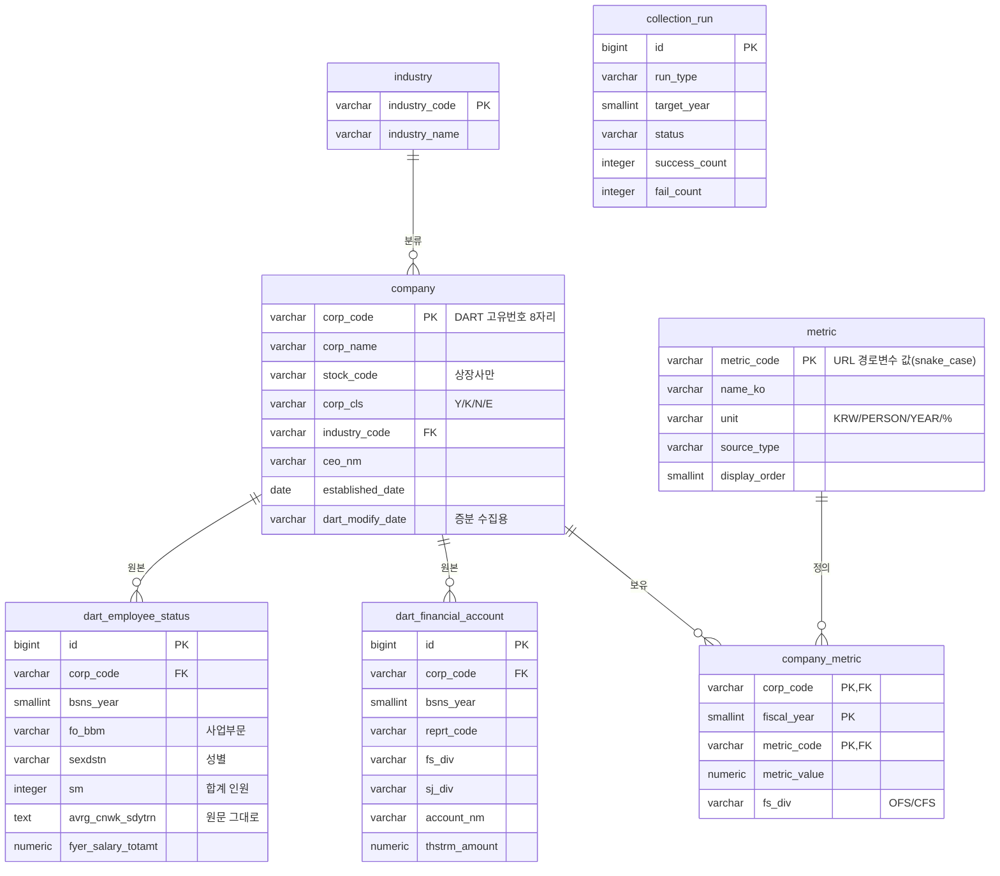

# DB 스키마 설계 (F-25)

- 대상 이슈: `S15P21A504-34`
- DBMS: PostgreSQL 18
- 기준 문서: Notion [기업분석 API 명세서](https://app.notion.com/p/3c97eaa01a88802ab705fdae578e3b54) (F-33, 완료)
- 마이그레이션: Flyway (`backend/src/main/resources/db/migration/`)

---

## 1. 설계 원칙

**지표를 컬럼이 아니라 행으로 둔다.** API 명세가 `/metrics/{metric}` 형태로 지표를 경로변수에 두므로,
지표를 `company_metric` 테이블의 컬럼(`revenue`, `operating_profit`, …)으로 만들면 컨트롤러에서
경로변수를 컬럼명으로 분기하는 코드가 생기고 지표 추가마다 DDL 변경이 필요하다.
`metric` 카탈로그 + `(corp_code, fiscal_year, metric_code)` 조합으로 두면 8개 엔드포인트가
모두 같은 테이블에 대한 조건절 차이로만 표현된다.

**원본과 가공본을 분리한다.** `dart_financial_account`에 DART 응답을 계정명 그대로 적재하고,
`company_metric`에는 매핑·정규화된 값만 넣는다. 계정 매핑 규칙(F-27)이 바뀌어도 DART를 다시
호출하지 않고 재처리할 수 있다. 조회 API는 `company_metric`만 읽는다.

---

## 2. ERD



---

## 3. API ↔ 쿼리 매핑

8개 엔드포인트가 모두 커버되는지 확인한 표다.

| 엔드포인트 | 읽는 테이블 | 핵심 조건 | 사용 인덱스 |
| --- | --- | --- | --- |
| `GET /api/companies` | `company` | `corp_name LIKE '%?%'` | `company_corp_name_trgm_idx` |
| `GET /api/companies/{corpCode}` | `company` + `industry` | PK 조회 | PK |
| `GET .../metrics` | `company_metric` + `metric` | `corp_code=? AND fiscal_year=?` | PK 선두 |
| `GET .../metrics/{metric}` | `company_metric` | `corp_code=? AND fiscal_year=? AND metric_code=?` | PK |
| `GET .../metrics/timeseries` | `company_metric` | `corp_code=? AND fiscal_year BETWEEN ? AND ?` | PK 선두 |
| `GET .../metrics/{metric}/timeseries` | `company_metric` | `corp_code=? AND metric_code=?` | `company_metric_timeseries_idx` |
| `GET .../industry-comparison` | `company_metric` ⋈ `company` | 대상 기업의 `industry_code` 동일 + `fiscal_year=?` | `company_industry_code_idx` |
| `GET .../metrics/{metric}/industry-comparison` | `company_metric` ⋈ `company` | 위 + `metric_code=?` | `company_metric_comparison_idx` |

산업 비교는 2단계다. 먼저 `company`에서 대상 기업의 `industry_code`를 얻고,
같은 산업의 `corp_code` 집합에 대해 `company_metric`을 조회한다.

```sql
SELECT c.corp_code, c.corp_name, cm.metric_value
FROM company_metric cm
JOIN company c ON c.corp_code = cm.corp_code
WHERE c.industry_code = (SELECT industry_code FROM company WHERE corp_code = :corpCode)
  AND cm.fiscal_year = :year
  AND cm.metric_code = :metric
ORDER BY cm.metric_value DESC;
```

---

## 4. 타입 선택 근거

| 선택 | 이유 |
| --- | --- |
| `corp_code`를 `VARCHAR(8)` + 정규식 CHECK | `CHAR(n)`은 공백 패딩 때문에 JDBC로 읽을 때 값 끝에 공백이 붙어 비교가 어긋난다. PostgreSQL에서 `CHAR`는 저장 공간 이득도 없다. |
| `metric_value`를 `NUMERIC(24,4)` | 금액은 원 단위 정수지만(삼성전자 자산총계 약 5×10^14) 비율·평균 근속연수 같은 소수 지표가 추가될 수 있어 소수부를 남겨 둔다. 부동소수점은 금액 비교에 부적합하다. |
| `metric_code`를 snake_case | 명세서가 `revenue`·`operating_profit`·`employee_count`·`avg_salary`·`avg_tenure`·`rd_ratio`로 확정. URL 경로변수 값과 DB 값을 동일하게 두어 컨트롤러에 매핑 코드가 생기지 않게 한다. |
| `avrg_cnwk_sdytrn`만 `TEXT` | 착지 테이블의 다른 수치는 자릿수 구분자만 제거하면 숫자지만, 평균 근속연수는 회사별 표기가 제각각이라 원문을 보존하고 F-27에서 파싱한다. |
| `fiscal_year`를 `SMALLINT` | 2021~2025 범위. CHECK로 1900~2100 제한. |

---

## 5. 다른 작업과의 경계

- **F-39 (PostgreSQL 컨테이너 초기화, 이민재)** — 스키마 생성은 Flyway가 애플리케이션 기동 시
  수행하므로 compose의 `docker-entrypoint-initdb.d`에 DDL을 넣지 않는다. 컨테이너는 빈 DB와
  `pg_trgm`을 만들 수 있는 권한만 제공하면 된다(`POSTGRES_USER`가 superuser이므로 현재 설정으로 충분).
- **F-27/F-28 (계정 매핑·Upsert, 여성욱)** — `dart_financial_account`가 착지 테이블,
  `company_metric`이 upsert 대상이다. `company_metric`의 upsert 키는 PK
  `(corp_code, fiscal_year, metric_code)`이므로 `ON CONFLICT` 절이 그대로 성립한다.
  `dart_financial_account.corp_code`가 `company`를 참조하므로 **기업 마스터(F-04) 적재가 재무 수집보다 먼저**여야 한다.
- **F-31 (Spring Boot·DB 연결, 본인)** — datasource 설정은 F-31에서 다룬다.
  compose는 이미 `SPRING_DATASOURCE_*` 환경변수를 주입하므로 컨테이너 환경에서는 값 주입이 따로 필요 없고,
  로컬 실행용 프로파일만 F-31에서 채우면 된다.

  > **의존성은 이 MR 이 아니라 F-31 이 소유한다.** 이 브랜치는 마이그레이션 파일과 설계 문서만 담는다.
  > Flyway·JPA 스타터를 여기서 넣으면 F-31 과 같은 줄에서 충돌하고, 무엇보다
  > Spring Boot 4 는 자동설정을 기술별 모듈로 쪼개 두어 `org.flywaydb:flyway-core` 만으로는
  > **자동설정이 붙지 않아 마이그레이션이 조용히 실행되지 않는다**(F-31 에서 실제로 겪었다).
  > `org.springframework.boot:spring-boot-flyway` 를 써야 하며, 그 결정과 검증은 F-31 에 있다.

---

## 6. 미결 사항

명세서(F-33)로 해소된 것: 지표 6종 키 확정, `metric_code` 표기(snake_case), 식별자는 `corpCode`(DART 고유번호).

1. **`rd_ratio` 조달 경로가 없다.** DART 정기보고서 주요정보 API 30개에 연구개발비·연구개발활동 항목이
   없음을 확인했다. 단일회사 **전체** 재무제표에서 `경상연구개발비` 계정을 찾는 방법은 판관비에 묶어
   공시하는 회사가 많아 커버리지가 보장되지 않고, XBRL 파싱은 MVP 대비 비용이 크다.
   명세가 `"value": null`을 허용하므로 스키마는 행 부재로 대응되지만, **F-24에서 표본 검증 후
   수집/제외를 결정**해야 한다.
2. **산업 분류를 무엇으로 채울지 미정.** 명세서 상위 페이지에 *"OpenDART는 기업별 업종코드를 깔끔하게
   주지 않습니다. KRX 업종분류 또는 KSIC 매핑 테이블을 별도로 넣어야 하며, 이것이 05번 API의 숨은
   난이도"* 라고 적혀 있다. 응답 예시의 `industryCode: "26"`은 KSIC 대분류 2자리다.
   `industry` 테이블 구조는 코드·명 2컬럼이라 어느 소스든 수용하지만, **적재 소스가 정해져야 한다.**
3. **연결/개별 재무제표 기준.** `fs_div`를 값으로만 보관하고 어느 쪽을 대표값으로 쓸지는 정하지 않았다.
   비교 가능성을 위해 한쪽으로 통일하는 규칙이 필요하다(일반적으로 연결 CFS 우선, 없으면 개별 OFS).
4. **`unit` 값 2개가 명세에 없다.** 명세 예시는 `KRW`와 `%`만 보여준다. `employee_count`를 `PERSON`,
   `avg_tenure`를 `YEAR`로 시드했으나 FE가 이 문자열로 포맷을 분기한다면 값 합의가 필요하다.

---

## 7. 응답 필드와 스키마 대응

명세의 성공 응답 필드가 전부 조달되는지 확인한 표다.

| 응답 필드 | 출처 |
| --- | --- |
| `corpCode`, `corpName`, `stockCode` | `company` 동명 컬럼 |
| `industryCode`, `industryName` | `industry` 조인 |
| `market` (KOSPI/KOSDAQ/KONEX) | `company.corp_cls`(Y/K/N)에서 파생 |
| `ceo`, `establishedDate` | `company.ceo_nm`, `company.established_date` |
| `metrics[].key`, `.label`, `.unit` | `metric` 카탈로그 |
| `metrics[].value` | `company_metric.metric_value`, 행이 없으면 `null` |
| `metrics[].yoy.prevValue` | 같은 테이블의 `fiscal_year - 1` 행 |
| `metrics[].yoy.changeRate` | 조회 시 계산. 전년 값이 없거나 0이면 `null` |

`yoy`는 저장하지 않는다. 전년 행이 같은 테이블에 있어 조회 시점에 계산하면 되고,
값을 저장하면 재적재 때 원본과 어긋날 여지가 생긴다.

---

## 8. 검증

PostgreSQL 18.6 컨테이너에 `psql -v ON_ERROR_STOP=1` 로 V1·V2를 적용해 확인했다.

**적용 결과** — 오류 없이 통과. 테이블 7개, 인덱스 17개, `metric` 시드 6행 생성.

**조회 쿼리** — 8개 엔드포인트가 쓸 쿼리 형태를 표본 데이터로 실행해 확인했다.

| 확인 항목 | 결과 |
| --- | --- |
| 단일지표 시계열 (`corp_code` + `metric_code` 필터, 연도 정렬) | 정상 |
| 산업 비교 (대상 기업의 `industry_code` 로 동종 기업 조회) | 정상 |
| yoy 계산 (전년 행 self-join, 전년 0이면 `NULL`) | 정상. 명세 예시와 동일한 `7.3` 산출 |
| 소수 지표 보존 (`avg_tenure` = 11.5) | 정상 |
| 기업명 부분일치 검색 | 정상 |

**제약조건** — 잘못된 데이터가 실제로 거부되는지 확인했다.

| 시도 | 결과 |
| --- | --- |
| `corp_code` 7자리 | 거부 (`company_corp_code_check`) |
| `corp_cls = 'X'` | 거부 (`company_corp_cls_check`) |
| 존재하지 않는 `metric_code` 참조 | 거부 (FK) |
| 기업·연도·지표 중복 | 거부 (PK) |
| 존재하지 않는 기업 참조 | 거부 (FK) |
| `unit = 'DOLLAR'` | 거부 (`metric_unit_check`) |
| `ON CONFLICT` upsert | 성공 (F-28 이 쓸 경로) |

**주의 — 조회 결과의 소수 자릿수.** `metric_value` 가 `NUMERIC(24,4)` 라서 금액도
`71000000000000.0000` 형태로 나온다. 명세는 `"value": 71000000000000` 을 기대하므로
**응답 직렬화 시 `metric.value_scale`(금액 0, 근속연수 1)로 자릿수를 맞춰야 한다.**
F-08 구현 시 처리한다.
